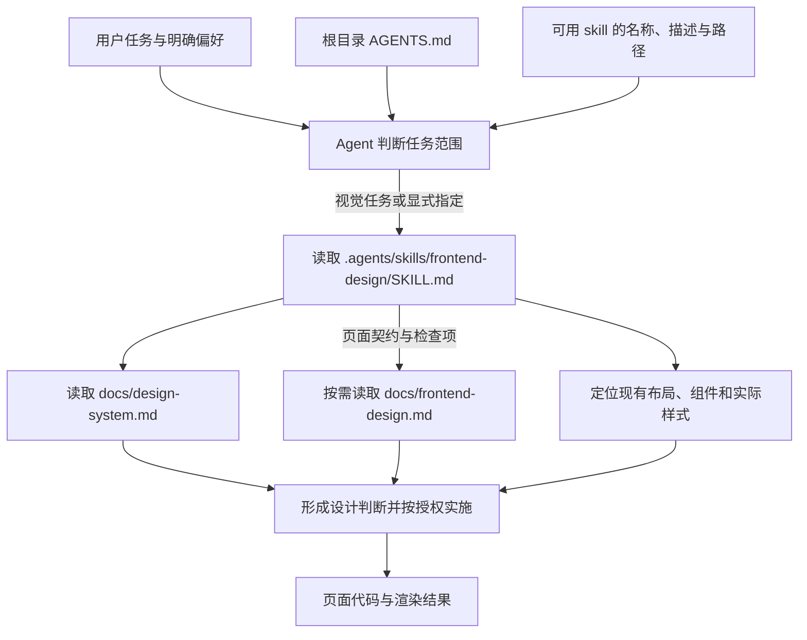

# 前端现状与改进方向

记录日期：2026-10-14。

后续状态：旧 `frontend-design` skill 已移除，视觉规范已迁至根目录 [DESIGN.md](../DESIGN.md)；全站改造决策见 [ADR 0003](adr/0003-adapt-antdv-next-design-to-astro.md)。下文记录当时停用前后的历史检查，不作为当前文件路径或实施方案。

本文汇总本轮对前端代码、项目设计规范及 AI 设计方法的检查，作为后续讨论与改进的依据。它是一份现状快照，不替代现有设计规范，也不代表已批准的全站改造方案。

## 1. 结论与检查边界

项目已经具备共享布局、品牌配色、常用组件、中英文路由和响应式规则。当前最需要补齐的是：将排版与空间规则落实到共享实现，并建立对真实渲染结果的检查流程。

用户反馈是“生成的样式不统一也不美观”。本轮检查发现了可解释这一反馈的代码与流程问题，但没有运行页面、截图或开展用户测试，因此不能把这些原因全部视为已经验证的视觉结论。

本轮覆盖：

- 首页、臻彩详情、博客列表及两篇代表性博客文章的结构与样式。
- `BaseLayout`、共享控件、卡片及 `src/styles/global.css` 的相关规则。
- `docs/design-system.md`、`docs/frontend-design.md` 与本地 `frontend-design` skill。
- Anthropic `frontend-design` 原文，以及《如何使用 AI 做出顶级的 UI 设计》本地总结。

没有覆盖全部路由、所有运行时状态、实际字体渲染、性能测量和完整无障碍审计。

## 2. 已有基础

| 领域 | 当前实现 | 后续应复用的能力 |
| --- | --- | --- |
| 技术与内容 | Astro 静态站，构建时读取目录数据；部分资料页在浏览器中加载 CommunityDragon 补充内容 | 保持静态内容与浏览器增强的职责边界 |
| 品牌 | 暗色原画展馆方向，Chroma Gold 为主题强调色 | 继续让原画承担主要视觉，保持色彩语义一致 |
| 全站布局 | `BaseLayout` 共用 Header、Footer 与页面基础能力 | 页面升级沿用共享导航和品牌表达 |
| 组件 | 已有原画卡片、筛选、输入、选择、分页、面包屑、图片查看器、返回顶部等 | 同类控件优先复用现有组件 |
| 样式 | 全局变量覆盖颜色、版心、页面边距、触控尺寸与 Header 高度 | 在现有变量上收拢重复规则 |
| 体验契约 | 已记录中英文、断点、图片回退、键盘与减少动效等要求 | 设计升级时保留并验证这些契约 |

实现依据：[BaseLayout](../src/layouts/BaseLayout.astro)、[共享样式](../src/styles/global.css)、[视觉规范](../DESIGN.md)、[前端设计文档](frontend-design.md)。

## 3. 已确认的代码与流程问题

### 3.1 共享视觉规则不够完整

当前全局变量主要规定颜色与布局尺寸，没有形成供各页面共同使用的字号层级、间距尺度、圆角和边框层级。规范要求这些维度统一，但实现中仍由页面分别填写数值。

页面拥有局部样式本身是合理的；问题在于同类信息和公共规则也由多个文件分别维护，修改时容易只更新其中一处。

具体证据：

- 首页 `.hero-content` 与 `.latest-section` 写死 `1240px` 和 `48px`，目录则使用 `--content-width`、`--page-gutter`。
- 全局边距在 `767px` 及以下切换，首页上述两个区域到 `680px` 才切换。在 `681–767px` 范围内，首页不同区域使用不同的左右边距。
- 详情页资料列宽通过局部 `!important` 覆盖共享规则，增加了后续调整时判断实际生效样式的成本。

证据位置：[首页](../src/pages/index.astro)、[共享样式](../src/styles/global.css)、[臻彩详情](../src/pages/chromas/[slug].astro)。

### 3.2 博客文章重复维护基础排版

代表性文章分别定义 `.blog-article`、`.article-header`、标题、正文、图片、FAQ 和手机端规则，其中大量内容相同，部分值已存在差异。例如，两篇文章的手机标题字号公式和链接修饰范围不同。

文章特有的图片编排可以保留局部实现；基础阅读排版适合共同维护。否则统一修改标题比例、正文行长或段落间距时，需要逐篇同步，后续新文章也容易复制旧规则。

证据位置：[什么是臻彩](../src/pages/blog/what-are-prestige-chromas.astro)、[26.19 版本文章](../src/pages/blog/patch-26-19-prestige-chromas.astro)。

### 3.3 设计 skill 与验证契约不一致

本地 skill 将渲染效果交给用户人工查看，并明确排除截图与视觉回归；项目文档第 17 节则要求对真实页面进行桌面和手机视觉验证。

skill 同时排除测试、类型检查和构建，而仓库 `AGENTS.md` 要求按变更风险执行相关验证。执行时应遵循更高优先级的仓库与用户指令；维护 skill 时需要消除这些冲突，避免让视觉任务绕开必要检查。

代码检查可以确认规则是否存在，无法完整确认实际换行、图片裁切、内容遮挡和视觉层级。当前流程缺少 Agent 查看渲染结果并针对明确问题修正的步骤。

证据位置：当时的 `frontend-design` skill（现已移除）；当前检查入口见[前端流程与协作](frontend-design.md#4-流程与协作)。

## 4. 需要渲染验证的设计判断

### 4.1 首页是否足够直接地服务原画浏览

首页结构为全视口 Hero、最新文章、图鉴。Hero 主要呈现站点标题与说明，精选作品作为背景出现，没有在该区域展示作品身份和明确的作品详情入口。

如果主要任务是查找或欣赏原画，这种顺序可能让用户较晚进入图鉴。应结合真实首屏检查：用户是否能识别精选作品、发现浏览入口，以及最新文章是否应拥有当前的展示优先级。

这一判断尚未经过用户行为验证；不能仅凭结构就认定必须缩短 Hero 或移动文章区。

### 4.2 装饰是否真正帮助表达内容

页面已有衬线大标题、金色强调、全大写标签、卡片边框、扫光和滚动提示等表达。这些手法都可以适合本站，但组合后是否增强了原画体验，需要看真实画面。

评审应检查主次关系、文字对作品主体的遮挡、图片尺度、对齐和留白，再决定是否删减装饰。不能仅因某种手法常见于 AI 页面就将其删除。

### 4.3 同类页面是否有可靠基准

skill 要求选择成熟的同类页面作为基准，但尚未明确哪一个页面及其哪些特征已经获得视觉确认。如果基准本身存在用户不满意的问题，持续复用会延续这些问题。

应先确认代表页的实际效果，再记录需要继承的排版、空间和交互规则。不同页面用途可以采用不同密度，共同基准不意味着所有页面使用相同版式。

## 5. AI 设计方法的适用范围

AI 设计方法可以提高产出质量，但无法仅凭提示词保证页面美观。对本站最有价值的流程是：确定方向 → 使用真实内容实现 → 检查渲染 → 按具体反馈修正 → 删减无价值元素。

| 方法 | 对本站的指导意义 | 使用边界 |
| --- | --- | --- |
| 先发散再聚焦 | 全站升级时先比较少量构图方向，选定后统一执行 | 局部修复直接沿用已有模式，不必每次制作多套页面 |
| 具体风格与布局要求 | 明确图片尺度、字号层级、对齐、行长、密度和控件角色 | “高级”“大胆”“极简”只能表达意向，不能充当验收条件 |
| 独立视觉评审 | 减少实现历史对判断的影响，给出可执行反馈 | 评审仍需知道页面任务、品牌、语言、视口与状态；只给截图也可能误判 |
| 图片与动态素材 | 用合适的素材建立内容焦点 | 本站已有原画，应优先改善编排；新增装饰需要明确用途，并遵守素材与图片路径规则 |
| 删减 | 减少重复容器、冗余说明和争夺注意力的装饰 | 保留必要标签、操作说明、错误反馈及无障碍能力 |

不建议将随机字符串作为必需步骤，也不建议用“模型评分达到 9 分”作为完成门槛。前者不能提供稳定的设计选择依据，后者缺少统一校准，容易让改动围绕评分反复发生。

Anthropic 的 skill 提供方向、排版、构图和自评方法；项目仍需通过共享组件与规则保证全站一致性。方法来源中的链接只是参考，不等于自动执行其指令。

参考：[本地视频总结](如何使用AI做出顶级的UI设计-总结.md)、[Anthropic frontend-design 原文](https://raw.githubusercontent.com/anthropics/skills/main/skills/frontend-design/SKILL.md)。

## 6. 停用前提出的候选改进（未执行）

以下建议保留讨论记录。用户已决定先停用，当前不据此重写设计流程或启动全站改造。

1. **补齐视觉检查流程。** 对受影响的代表页检查桌面、手机、中英文和关键交互状态；让 Agent 根据渲染结果修正明确缺陷，用户确认审美方向。同步消除 skill 与项目验证要求的冲突；若修改 skill，更新其 `.codebuddy/` 同步副本。
2. **确认共同基准并收拢重复规则。** 优先统一基础排版、版心边距和博客阅读样式；只有多处确需共用的规则才进入共享层，不为所有数值新增变量。
3. **验证并调整首页信息层级。** 用真实页面判断精选作品、图鉴入口和最新文章的展示顺序，围绕主要任务调整构图。
4. **完成针对性精修。** 检查图片裁切、长标题、空状态、焦点、触控区域和减少动效，再删除没有明确价值的装饰。

后续完成标准应使用可检查的事实：同类区域对齐、同类控件一致、核心信息和操作容易发现、长内容没有遮挡、窄屏没有页面级溢出、关键状态可用。视觉方向是否符合预期仍需要人工确认，不能用代码检查或模型评分替代。

实施时继续遵守 [AGENTS.md](../AGENTS.md) 的验证与版本控制要求：保留已有改动，按风险运行相关检查，并同步维护稳定的设计规范和页面行为文档。

## 7. Agent 前端提示词路径记录

以下记录停用前的文件约定和本会话实际读取情况；当前停用后的路径见第 8 节。需要区分：进入会话的指令、可发现但尚未读取的 skill、按需读取的文档，以及仅被链接引用的参考资料。

### 7.1 停用前的 Codex 主路径

Codex 会先获得 skill 的元数据，再在决定使用时读取完整 `SKILL.md`；用户可以显式指定 skill，也可以由任务与描述匹配触发。仓库 `.agents/skills/` 是本地发现路径之一。[OpenAI 官方 skill 文档](https://learn.chatgpt.com/docs/build-skills)

`AGENTS.md` 是项目指令入口，本会话已获得其内容。Codex 的指令发现会结合全局与项目目录层级；本文只核实项目入口，不枚举个人环境的完整配置。[OpenAI 官方 AGENTS.md 文档](https://learn.chatgpt.com/docs/agent-configuration/agents-md)

本轮最初由用户显式指定 `frontend-design`，随后读取了 skill 正文、视觉规范、页面契约和相关代码。文档整理任务沿用这些已读信息，不代表每个任务都会重新加载全部前端文件。

### 7.2 停用前各入口的职责与加载条件

| 入口或文件 | 何时参与任务 | 对前端结果的具体影响 |
| --- | --- | --- |
| 用户当前请求与已确认偏好 | 随任务进入会话 | 决定改动范围、期待的效果、是否只评审、是否需要多方案 |
| 当前会话约束，例如 Ponytail | 由当前会话提供；其他会话不一定启用 | 限制无关重构、依赖和抽象，要求最小完整改动；不提供本站视觉语言 |
| `AGENTS.md` | 项目指令入口；本会话已加载 | 规定视觉任务使用前端 skill，要求双语、移动端、无障碍、SEO 与按风险验证；默认控制浏览器、联网和子代理使用范围 |
| `.agents/skills/frontend-design/SKILL.md` 的 `name`、`description` | 可用 skill 列表提供发现线索 | 将页面设计、视觉升级、响应式和界面评审路由到该 skill；纯数据、文案和非视觉逻辑不触发 |
| 同一文件的正文 | skill 被选用后读取 | 规定先判断信息层级、保持全站一致、复用组件、选择一个推荐方向、按领域交付；也包含当前的截图与验证限制 |
| `docs/design-system.md` | 前端 skill 的最小上下文要求读取 | 规定暗色展馆、金色语义、品牌字标、Header、背景和部分页面视觉规则 |
| `docs/frontend-design.md` | 页面契约有疑问或修改涉及相应领域时按章节读取；检查时查第 17 节 | 约束页面结构、响应式、交互、图片、双语和 SEO；第 16.3 节提供视觉验收矩阵 |
| `src/layouts/`、`src/components/`、`src/styles/global.css` 与目标页面 | 实施或评审前定位实际消费者 | 提供能复用的实现和邻近风格；最终外观由生效的代码决定，文字规范不会自动更新 CSS |

上表描述参与路径，不是一条能覆盖所有指令冲突的简单优先级。用户明确要求优先于 skill 指南；仓库验证要求也不能被 skill 中的“不运行测试”排除。`docs/frontend-design.md` 关于代码与历史文档的排序用于核实现有能力，不能解释为旧实现永远高于用户授权的设计升级。

### 7.3 CodeBuddy IDE 的另一条路径

仓库另有 `.codebuddy/skills/frontend-design/SKILL.md`。文件声明自己是 `.agents/skills/frontend-design/SKILL.md` 的同步副本；`.codebuddy/skills/README.md` 描述了按 `description` 匹配的自动触发方式。

该路径面向 CodeBuddy，不是当前 Codex 会话的权威 skill 入口。本轮未运行 CodeBuddy 或检查其加载日志，因此这里只确认文件约定，不宣称 IDE 实际加载已通过验证。

停用前发现的维护问题：

- `.gitignore` 忽略整个 `.codebuddy/`，其内容不随仓库提交分发。其他机器上的副本是否存在、是否一致，需要单独核实。
- 两侧正文曾存在差异：权威源在组件复用与交付示例中使用 `PrestigeChromaCard`，IDE 副本仍使用 `ChromaCard` 和 `src/components/ChromaCard.astro`；实际组件是 `src/components/PrestigeChromaCard.astro`。本次停用时已对齐这两处名称。

本次停用已同步本机副本并设置手动调用限制。其仍被 Git 忽略，其他机器的副本不随本次仓库改动分发；本轮未验证 CodeBuddy 运行时加载结果。

### 7.4 相邻任务与参考资料的路径

| 情况 | 实际入口 | 与主路径的关系 |
| --- | --- | --- |
| 新增博客文章 | `.agents/skills/blog-article/SKILL.md` → `CONTEXT.md`、文章检查表及按需读取的卡片参考 → `BaseLayout` 和博客组件 | 主要约束内容、SEO、双语与组件使用；前端 skill 暂停后，视觉需求直接按用户要求处理。纯文案任务不应扩大成视觉重做 |
| 明确探索 UI 原型 | `.agents/skills/prototype/SKILL.md` → `UI.md` | 用于回答设计问题的临时多方案原型，不能自动替代正式页面的统一设计规则，也不会在日常前端任务中全部加载 |
| Anthropic 等外部设计方法 | 前端 skill 的“方法来源”链接 | skill 明确声明这些链接不是运行依赖，仅在追溯或更新时读取；列出链接不等于安装或自动执行原文 |
| `docs/如何使用AI做出顶级的UI设计-总结.md` | 用户明确要求读取，或任务中主动将其作为参考 | 已在本轮进入分析上下文，但目前没有被 `AGENTS.md` 或前端 skill 设为必读文件；它提出的子代理、评分等方法不会因此自动执行 |
| 本文 | 用户要求阅读或后续任务将其作为上下文 | 记录现状、证据和建议；没有接入前端 skill 的必读路径，不会仅因保存在 `docs/` 就自动改变 Agent 行为 |

### 7.5 后续应修改哪个位置

以下用于定位维护位置；前端 skill 只有在用户明确要求重新启用后才恢复执行。

| 想改变的行为 | 应维护的位置 |
| --- | --- |
| 哪类任务必须使用前端 skill、仓库级验证要求 | `AGENTS.md` |
| skill 是否容易被任务匹配 | 前端 skill 的 `description` |
| Agent 如何选择方向、复用组件、检查渲染和总结 | 前端 skill 正文，并同步 CodeBuddy 副本 |
| 全站字体、色彩、空间与组件视觉规则 | `docs/design-system.md`，同时更新相应共享实现 |
| 页面结构、响应式行为、交互和验收契约 | `docs/frontend-design.md`，同时更新对应页面与组件 |
| 页面实际外观 | 布局、组件、共享样式和页面代码 |
| 让新的方法总结稳定参与后续视觉任务 | 在适用入口中明确引用与读取条件；仅新增总结文件不足以接入 |

提示词链路的维护重点是让入口、规则、实现与检查互相对应。新增参考资料可以帮助当前讨论；要持续影响后续任务，还需要把适用规则接入实际读取路径，并消除既有冲突。

## 8. 停用决定与缺乏实际指导价值的内容

### 8.1 当前停用范围

用户明确反馈：实践下来效果不好，未产生有效指导，项目先停用该前端提示词链路。当前实施如下：

- `AGENTS.md` 取消视觉任务强制使用前端 skill，改为按用户要求、实际代码和相关功能契约执行。重新启用需要用户明确要求。
- `.agents/skills/frontend-design/agents/openai.yaml` 设置 `policy.allow_implicit_invocation: false`，关闭 Codex 隐式调用。此设置仍允许显式调用，因此 skill 正文另行明确：暂停期间仅作历史记录，恢复执行需用户明确要求。[OpenAI 官方调用策略说明](https://learn.chatgpt.com/docs/build-skills)
- `.codebuddy/skills/frontend-design/SKILL.md` 同步暂停状态，并设置 `disable-model-invocation: true`，按本地 IDE 使用指南限制为手动入口。
- `docs/design-system.md` 取消触发 skill 的指针；设计文档与总结保留为按需参考，不接入默认必读路径。

停用后的默认路径是：用户任务 → 仓库通用约束 → 实际页面、组件与样式 → 按需核对功能契约 → 实施并按风险验证。它不再自动经过前端设计 skill 和整套美学文档。

已有会话中读过的历史内容不会因修改文件从上下文中消失；本会话以后续用户停用要求为准。未通过新会话或 IDE 运行日志验证加载效果，文件配置检查不能替代运行时确认。

### 8.2 在本项目中未形成有效指导的内容

以下针对“能否指导 AI 生成统一、美观的页面”这一目标评估，不把功能正确性和工程维护要求一并判为无效。

| 内容 | 为何没有形成有效指导 | 当前处理 |
| --- | --- | --- |
| “精品数字原画展馆”“鲜明表达”“更有设计感” | 表达愿望，没有给出已认可的构图样例、图片与文字比例或具体选择依据；不同实现仍可都声称符合 | 保留历史意向，取消默认执行 |
| “全站风格统一是首要原则” | 未落实为共同维护的字号、空间和基础排版；页面仍存在重复规则和边距断点差异，口号无法保证一致性 | 记录实际差异，不将该原则当作完成证明 |
| “选择成熟的同类页面作基准” | 没有明确获认可的基准页及应继承的特征，容易把当前不满意的页面继续复制 | 保留讨论记录，不默认认定现有页面成熟 |
| “明确第一视觉焦点”“建立记忆点”“换主题检查” | 能提示思考，但没有渲染反馈和具体判断依据，不能定位标题遮挡、裁切、失衡等实际问题 | 不再据此承诺设计质量 |
| 默认一个推荐方案、直接实施 | 规定交付速度与数量，没有证明选定方向符合用户期待；缺少校准时会把第一种惯用方案直接写成代码 | 暂停该流程，按具体任务判断所需沟通与实现 |
| 只做代码自查、效果全部交给人工 | 实现者无法通过画面发现和修正视觉问题，却以“全端适配、无已知缺陷”为完成描述 | 停止把静态规则检查视为视觉验收 |
| skill 排除测试、类型检查和构建 | 与仓库验证要求冲突，增加执行歧义；这项限制不会提升美观程度 | 暂停的规则不执行，按 `AGENTS.md` 验证 |
| 固定领域格式、强调总结怎样写 | 提升定位与可读性，但不能改变生成页面的排版和构图，不能替代效果检查 | 保留为历史交付约定，不作为设计能力的证据 |
| 方法来源链接 | 原文没有默认加载，也没有转化成项目内可执行依据，列出知名方法不会自动产生效果 | 保留资料出处，取消对自动生效的期待 |
| 随机种子、“9 分以上才完成” | 缺少稳定的选择依据和评分校准，无法保证统一或符合用户审美；目前也未接入项目 | 不引入为完成门槛 |
| 用生成图片、着色器和视频提升风格 | 素材种类本身不解决当前排版与一致性问题；项目已有原画，增加效果不等于改善浏览 | 不默认引入素材和特效 |

另有一类内容有工程价值，但对审美没有足够的新增指导：复用现有组件、双语文案、图片回退、键盘焦点、触控区域与减少动效。这些要求已经由仓库规则、组件或功能文档承担，无需依赖暂停的设计 skill 才能继续执行。

### 8.3 保留的有效约束与判断边界

暂停仅针对这条未达到预期的设计提示词链路。数据契约、路由、SEO、中英文、移动端可用性、无障碍、图片规则、测试与发布验证继续按任务执行；已有共享组件和实际品牌实现仍是项目现有能力。

本次不新建替代 skill，不把方法总结接入自动流程，也不通过继续追加审美口号修补旧 skill。后续如需重新探索设计，应从用户给出的具体页面、缺陷或参考效果开始。

停用依据是用户实践反馈及本轮记录的代码、规则和路径问题。尚未做受控对照实验，不能将“这套项目规则未达到预期”扩大为“所有 AI 设计方法均无效”。
